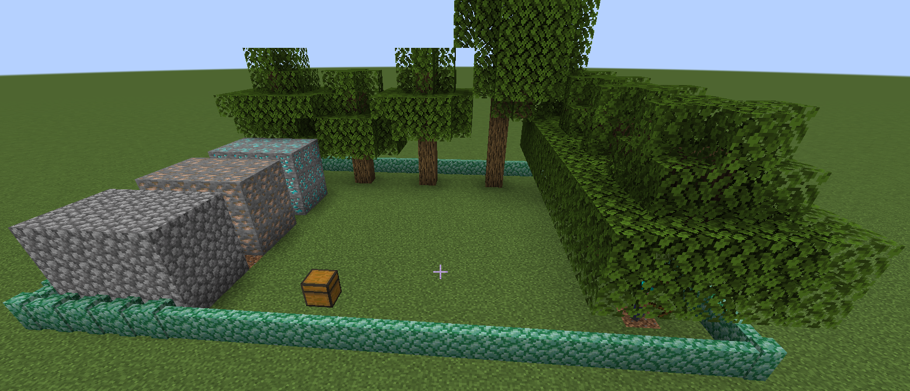
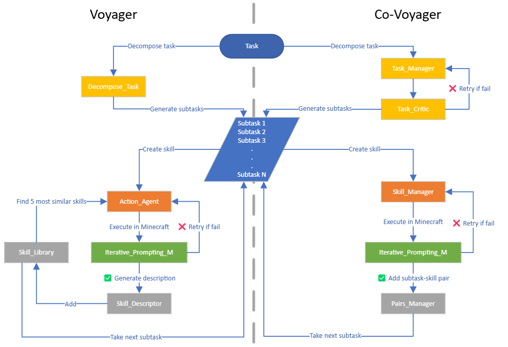
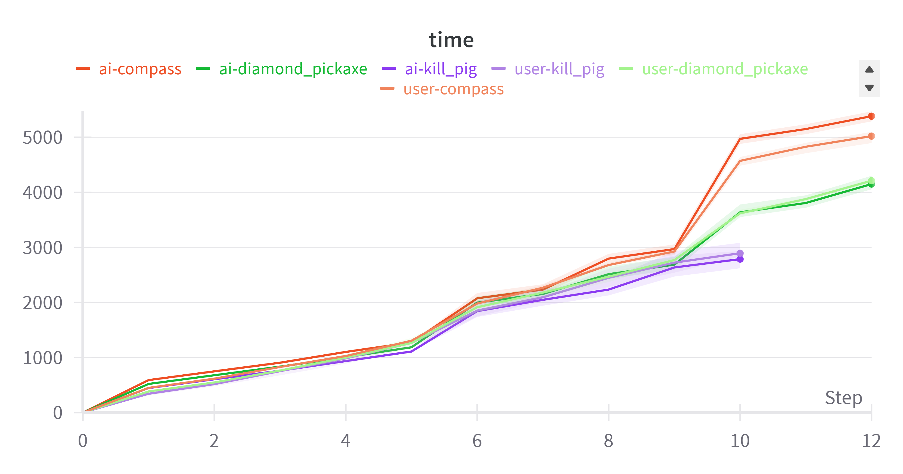
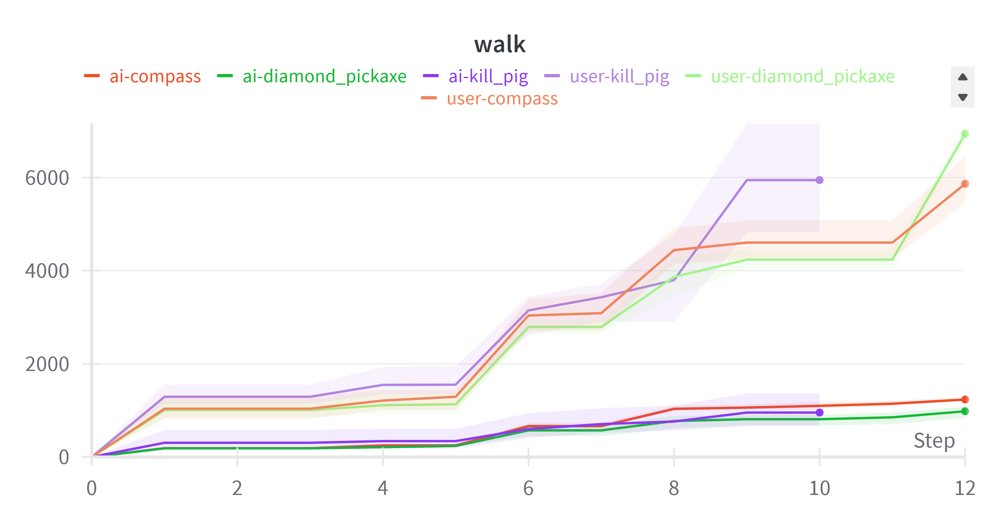

# Co-Voyager: Cooperative Task Decomposition for Minecraft

Co-Voyager is a **fork of [Voyager](https://github.com/MineDojo/Voyager)** that extends the original open-ended embodied agent into a framework that **collaborates with humans or multiple AI agents** to solve complex, goal-oriented tasks in Minecraft.

This repository was developed as the final project for the *Grounded Language Processing (GLP)* course at the **University of Trento**.

---

## Table of Contents
1. [Motivation](#motivation)
2. [Key Differences from Voyager](#key-differences-from-voyager)
3. [Quick Start](#quick-start)
4. [Project Structure](#project-structure)
5. [Experiments & Results](#experiments--results)
6. [Citation](#citation)
7. [License](#license)
8. [Project Status & Lessons Learned](#project-status--lessons-learned)

---

## Motivation
Large Language Model (LLM) agents such as Voyager exhibit impressive **lifelong learning** abilities but are limited when multiple subtasks must be carried out **in parallel** or when **human cooperation** is needed.  Co-Voyager addresses this by introducing a task-centric architecture that:

* Decomposes high-level goals into JSON subtasks that are easy to parse.
* Distributes those subtasks between **human players and AI agents**.
* Re-uses skills within the same execution via an explicit *Pair Manager*.
* Enforces correctness through a *Task Critic* that iteratively refines plans.

> **Note** The Minecraft world used in our experiments was **hand-crafted** to provide a minimal, noise-free arena for evaluation.  The world file is **not included** in this repository, so results cannot be reproduced one-to-one without rebuilding a similar map.




## Key Differences from Voyager
| Component            | Voyager                               | Co-Voyager |
|----------------------|----------------------------------------|------------|
| **Task Manager**     | Simple curriculum for exploration      | JSON-based hierarchical **task decomposition** with dependencies |
| **Skill Generation** | Few-shot examples + skill library      | **Primitive-only** generation, checks for materials & tools |
| **Skill Re-use**     | Global skill library across sessions   | *Pair Manager* re-uses skills **within the same task** |
| **Criticism**        | Skill-level critic                     | **Task-level critic** that validates entire plan |
| **Parallelism**      | Single autonomous agent                | Designed for **multi-agent / human-AI cooperation** |

<p align="center">
  
</p>

## Quick Start
### 1. Prerequisites
* Python ≥ 3.9
* Node.js ≥ 16
* Minecraft Java Edition (1.19 with Fabric loader 0.14.18)
* An **OpenAI API key** (for GPT-4 or GPT-3.5-Turbo)

### 2. Installation
```bash
# clone repository
git clone https://github.com/<your-user>/Co-voyager.git
cd Co-voyager

# python dependencies
pip install -e .

# node dependencies (for Mineflayer backend)
cd voyager/env/mineflayer
npm install -g npx && npm install
cd mineflayer-collectblock && npm install && npx tsc
cd ../../..
```

For setting up Minecraft and Fabric mods follow the guides in `installation/`.

### 3. Running the Demo
```bash
python main.py
```
By default the script launches a run that asks the agent to **build a 4×4 wooden house with a fenced yard**.  Logs are tracked with *Weights & Biases*.

Alternatively you can use the lower-level API:
```python
from voyager import Voyager
from voyager.utils.components import get_agents, get_environment, get_recorder
from voyager.utils.config import get_azure_login, set_openai_config

set_openai_config()          # loads OPENAI_API_KEY from env vars
azure_login = get_azure_login()

env = get_environment(azure_login)
action_agent, curriculum_agent, critic_agent, skill_manager = get_agents()
recorder = get_recorder()

voyager = Voyager(
    env=env,
    skill_manager=action_agent,
    curriculum_agent=curriculum_agent,
    task_critic_agent=critic_agent,
    recorder=recorder,
)

voyager.learn_task("Build a wooden house 4x4 with a door and a gated-fence around it.")
```

---

## Project Structure
```
├── assets/               # images used in report & README
├── voyager/              # Co-Voyager source code (adapted from MineDojo/Voyager)
├── tasks/                # example high-level tasks in JSON
├── skill_library/        # example learned skills for baseline comparison
├── installation/         # step-by-step setup guides for Minecraft & Fabric
├── report.pdf            # full technical report (course submission)
└── main.py               # minimal reproducible experiment
```

---

## Experiments & Results
Co-Voyager was benchmarked against the original Voyager as well as human players on a suite of **construction tasks**.  Key findings:

* **↑ 3.4×** faster task completion time compared to a single Voyager agent.
* **↓ 47 %** reduction in total walking distance due to smarter subtask ordering.
* Comparable performance to human players on simple builds, with superior consistency on complex, multi-step objectives.

<p align="center">
  
  
</p>

Full details can be found in **report.pdf**.

---

## Citation
Please cite the original Voyager paper if this project contributes to your research:
```bibtex
@article{wang2023voyager,
  title   = {Voyager: An Open-Ended Embodied Agent with Large Language Models},
  author  = {Guanzhi Wang et al.},
  year    = {2023},
  journal = {arXiv preprint arXiv:2305.16291}
}
```

---

## License
This project inherits the original **MIT License** from Voyager. See [LICENSE](LICENSE) for details.

---

## Project Status & Lessons Learned
Co-Voyager is **not a production-ready system**––it is a proof-of-concept developed for an exam assignment.  Significant effort was spent reverse-engineering and refactoring the original Voyager codebase, which lacked comprehensive documentation.  Key takeaways:

* The repository is now **module-oriented and organized**, making future extensions easier.
* The initial research goal was to deeply analyse AI-AI and AI-human collaboration with a richer set of statistics beyond *walk* and *time*; however, time constraints limited the study scope.

---

*Co-Voyager is a research prototype: use at your own risk; no official endorsement by NVIDIA, Mojang, or OpenAI.*
